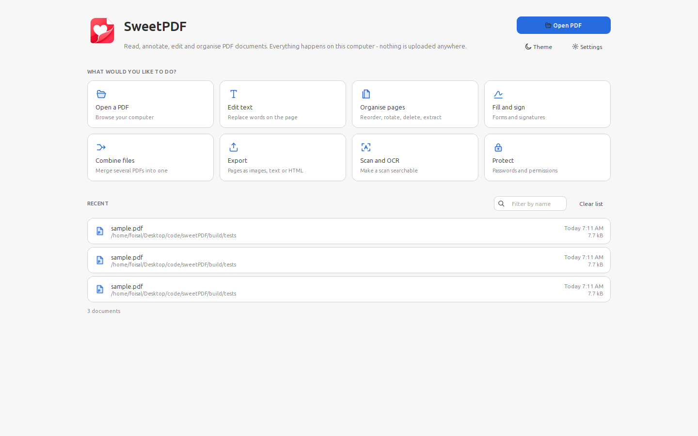
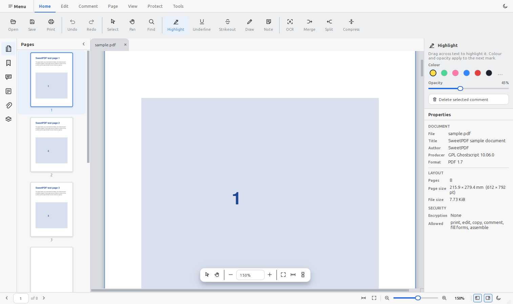
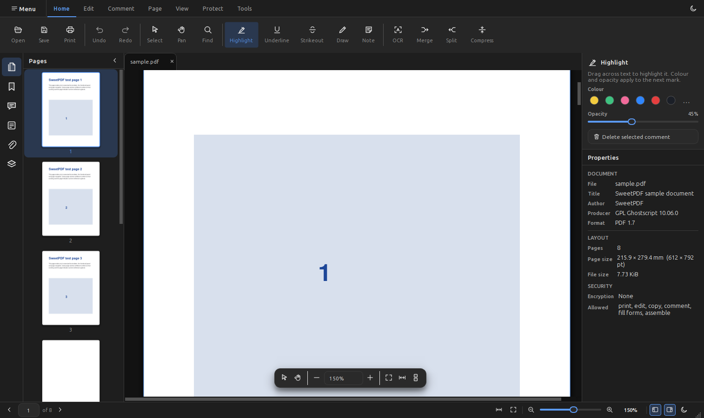

<p align="center">
  
</p>

# SweetPDF

**An all-in-one, open source PDF editor for Linux, Windows and macOS.**

Written in C++20 with Qt 6 and MuPDF, aiming to be a genuine alternative to
Acrobat rather than another read-only viewer. Everything happens on your own
computer: no account, no upload, no subscription.

> **Status: usable.** Viewing, text selection and search, markup, page
> organisation, form filling, signatures, redaction, encryption, OCR and export
> all work. Editing existing text is done by replacing it (the old glyphs are
> redacted away and retyped) rather than by re-flowing the original text.

<p align="center">
  
</p>

<p align="center"><em>Home screen — open a PDF, pick a task, or continue from Recent.</em></p>

## Contents

**Using SweetPDF** — [Install](#install) · [First five minutes](#first-five-minutes)
· [The window](#the-window) · [How do I…](#how-do-i) ·
[Shortcuts](#keyboard-shortcuts) · [Settings](#settings) ·
[Questions](#common-questions)

**Working on SweetPDF** — [Build from source](#build-from-source) ·
[Architecture](#architecture) · [Releases and CI](#releases-and-ci) ·
[Roadmap](#roadmap) · [Contributing](#contributing) · [License](#license)

**Project documents** — [Contributing guide](CONTRIBUTING.md) ·
[Changelog](CHANGELOG.md) · [Security policy](SECURITY.md) ·
[Code of conduct](CODE_OF_CONDUCT.md)

## Install

Grab the newest build from the [releases
page](https://github.com/foisalislambd/sweetPDF/releases). Every release lists a
`SHA256SUMS` file if you want to check your download.


| System                    | File                                     | What to do                                                                                           |
| ------------------------- | ---------------------------------------- | ---------------------------------------------------------------------------------------------------- |
| Ubuntu 26.04+, Debian 14+ | `sweetpdf_<version>_amd64.deb`           | `sudo apt install ./sweetpdf_*.deb`                                                                  |
| Other Linux               | `sweetpdf-<version>-linux-x86_64.tar.gz` | Unpack it and run `bin/sweetpdf`. Needs Qt 6.4+, MuPDF and Tesseract from your distribution.         |
| Windows 10/11             | `sweetpdf-<version>-windows-x86_64-setup.exe` | Run it. Installs into `Program Files` with a Start menu entry, and can offer SweetPDF in the *Open with* menu for PDFs. Uninstall from *Apps & features*. |
| Windows, portable         | `sweetpdf-<version>-windows-x86_64.zip`  | Unpack anywhere and run `sweetpdf.exe`. Nothing is installed and nothing is written to the registry, so the folder can live on a USB stick. |
| macOS                     | —                                        | Not built yet, see [Releases and CI](#releases-and-ci). Build from source in the meantime.           |


There is no telemetry and no auto-updater. To upgrade, install the newer package
over the old one; on Windows the installer removes the previous version first, so
no files from an older build are left behind.

## First five minutes

1. **Open a document.** Press the blue *Open PDF* button, pick a task tile, or
  drag a file onto the window. Anything you have opened before is one click away
   in the *Recent* list.
2. **Move around.** Scroll normally, `Ctrl+Wheel` to zoom, or type a page number
  in the status bar. `Ctrl+1` fits the page, `Ctrl+2` fits the width.
3. **Find something.** `Ctrl+F`, type, and every match in the document is
  highlighted. `F3` walks through them.
4. **Mark it up.** On the *Comment* tab pick Highlight, then drag across text. The
  right-hand panel switches to that tool's settings — colour and opacity — and
  they apply to what you draw next.
5. **Undo freely.** `Ctrl+Z` reverses anything, including page moves. Nothing
  touches the file on disk until you press `Ctrl+S`.

Nothing you do is destructive until you save, so the fastest way to learn the
program is to open a copy of something and try the tools.

## The window

<p align="center">
  
</p>

<p align="center"><em>Document view — ribbon, page thumbnails, canvas, and tool options.</em></p>

<p align="center">
  
</p>

<p align="center"><em>The same window in dark theme.</em></p>


| Part                                   | What it is for                                                                                                                                                                     |
| -------------------------------------- | ---------------------------------------------------------------------------------------------------------------------------------------------------------------------------------- |
| **Home screen**                        | Shown when no document is open: task tiles and recent files. The ribbon and panels are hidden here because they cannot do anything yet.                 |
| **Ribbon**                             | Commands grouped by job: *Home*, *Edit*, *Comment*, *Page*, *View*, *Protect*, *Tools*. The *Menu* button on the left holds the file commands, recent files, preferences and help. |
| **Navigation panel** (left, `Ctrl+B`)  | Six panels: *Pages* (thumbnails), *Marks* (bookmarks), *Notes* (comments), *Forms*, *Files* (attachments) and *Layers*.                                                            |
| **Page canvas**                        | The document. A small floating bar carries the select and pan tools, zoom, and the page layout modes.                                                                              |
| **Properties panel** (right, `Ctrl+J`) | Two parts. The top shows the settings of whichever tool is picked, and appears only when that tool has any. Below it: title, author, producer, page size, file size, encryption and what the document permits. |
| **Status bar**                         | Page number, zoom, layout and theme, with the page field ready for typing.                                                                                                         |
| **Tabs**                               | Several documents at once. With session restore on, they come back next time.                                                                                                      |


## How do I…


### Read and search

- **Change layout** — *View* tab: single page, continuous or two-page, plus
rotate-view which turns the display without changing the file.
- **Search** — `Ctrl+F`. The find bar can match whole words only or respect
case; results are highlighted everywhere at once, not one at a time.
- **Copy text** — drag with the select tool (`V`), then `Ctrl+C`. Selection
snaps to words and lines, so table columns copy cleanly.
- **Follow a link** — click it. Right-click a link to remove it.


### Comment and mark up

- **Highlight, underline, strike out** — pick the tool on the *Comment* tab and
drag across text. Its colour and opacity appear in the right-hand panel as soon
as you pick it, and apply to the next mark you make.
- **Draw or write** — *Draw* for freehand ink, *Note* for a sticky note, *Text*
for a box of typed text, plus rectangles and ellipses.
- **Review everything** — the *Notes* panel lists every annotation with its page
and author; clicking one scrolls to it. `Delete` removes the selected one.

Every mark is a real PDF annotation, so other viewers see them too.

### Organise pages

Open the *Pages* panel or the *Page* tab, then:

- **Reorder** — drag thumbnails.
- **Insert** — a blank page, or pages from another file.
- **Delete, rotate, extract** — select thumbnails first; extract writes the
selection to a new document. Right-click a thumbnail to duplicate it.
- **Merge** — *Combine files* on the home screen, or *Merge* on the *Page* tab,
appends other documents to this one.
- **Split** — cut the document into several files at a page range you choose.

Page operations are undoable like everything else.

### Edit content

- **Replace text** — select the words, then *Replace Text* on the *Edit* tab.
The originals are redacted away and your text is placed on top, so the old
words are really gone rather than covered up.
- **Add or swap a picture** — *Add Image*, then drag the box where it should go.
*Replace Image* swaps a picture you placed earlier.
- **Add a link** — *Link*, drag a box, and give it a URL or a page number.


### Fill in a form, and sign

- **Fill** — open the *Forms* panel. Every field is listed page by page with the
right editor: text boxes, checkboxes, dropdowns. Values go straight into the
document, and each change is one undo step.
- **Reset** — *Reset form* in the panel puts every field back to its default.
- **Sign** — *Sign* on the *Protect* tab. Draw with the mouse, type your name in a
handwriting style, or import a photo of your signature; then drag a box where
it goes, or apply it to every page.
- **Freeze it** — *Flatten* on the *Tools* tab turns fields and annotations into
ordinary page content so nobody can change them.

Cryptographic (PKCS#7) signatures are not implemented yet — see the
[roadmap](#roadmap).

### Protect a document

- **Encrypt** — *Protect* tab: AES-128 or AES-256, an open password and an owner
password, and a tick list of what is still allowed (printing, copying,
commenting, filling forms, assembling).
- **Redact** — mark regions with the redaction tool, then *Apply Redactions*.
The content underneath is removed from the file, not hidden.
- **Watermark** — text or an image, with rotation, opacity and a page range.


### Convert and export

- **Make a scan searchable** — *OCR* on the *Tools* tab runs Tesseract and adds
an invisible text layer, so the scan can be searched and copied.
- **Export** — pages as PNG or JPEG at a resolution you pick, the text as plain
text, or the document as HTML.
- **Print** — `Ctrl+P`, with the usual page range and printer options.
- **Compress** — rewrites the file with tighter object streams.


## Keyboard shortcuts


| Action                        | Shortcut                     |
| ----------------------------- | ---------------------------- |
| Open                          | `Ctrl+O`                     |
| Save / save as                | `Ctrl+S` / `Ctrl+Shift+S`    |
| Print                         | `Ctrl+P`                     |
| Undo / redo                   | `Ctrl+Z` / `Ctrl+Shift+Z`    |
| Find / next / previous        | `Ctrl+F` / `F3` / `Shift+F3` |
| Copy / select all             | `Ctrl+C` / `Ctrl+A`          |
| Delete selected comment       | `Delete`                     |
| Cancel placement or selection | `Esc`                        |
| Close document                | `Ctrl+W`                     |
| Zoom in / out                 | `Ctrl++` / `Ctrl+-`          |
| Actual size                   | `Ctrl+0`                     |
| Fit page / fit width          | `Ctrl+1` / `Ctrl+2`          |
| Select / pan tool             | `V` / `H`                    |
| Navigation panel              | `Ctrl+B`                     |
| Properties panel              | `Ctrl+J`                     |
| Zoom with the wheel           | `Ctrl+Wheel`                 |
| Pan temporarily               | Middle mouse drag            |


## Settings

*Menu → Settings*, also on the *Tools* tab and the home screen, keeps the handful
of preferences that change how the program behaves:


| Setting          | What it does                                                                                                                   |
| ---------------- | ------------------------------------------------------------------------------------------------------------------------------ |
| Author name      | The name written on annotations and comments you create.                                                                       |
| Dark mode        | Switches the theme. Also on the home screen and in the status bar.                                                             |
| Default zoom     | Fit width, fit page or actual size for newly opened documents.                                                                 |
| Restore session  | Reopens the documents that were open when you last quit.                                                                       |
| Incremental save | Appends changes to the end of the file, which is much faster on large documents. Turn it off to always rewrite the whole file. |


## Common questions

**Is my document uploaded anywhere?** No. There is no network code in the
program at all, apart from opening a link you click.

**Can it edit text like a word processor?** Not yet. Existing text is edited by
replacing a selection, which redacts the old glyphs and types new ones over the
top. Re-flowing original text runs is the next big item on the roadmap.

**Why is my scan not searchable?** It has no text layer. Run *OCR* on the
*Tools* tab, then save.

**The document opens but nothing can be changed.** Either the format is
view-only (XPS, EPUB, CBZ, SVG can be read but not edited), or the PDF's
permissions forbid it. The *Properties* panel shows what is allowed.

**A password is requested when I open a file.** That is the document's open
password; SweetPDF only asks the once and never stores it.

**Where are my settings stored?** In the usual place for your system:
`~/.config/SweetPDF/` on Linux, the registry on Windows, `~/Library/Preferences`
on macOS. Recent files and window layout live there too.

## Build from source


### Linux (Ubuntu 26.04 or newer, Debian 14 or newer)

```bash
sudo apt-get install -y --no-install-recommends \
  build-essential cmake ninja-build git pkg-config \
  qt6-base-dev qt6-base-dev-tools qt6-svg-dev qt6-tools-dev qt6-tools-dev-tools libgl1-mesa-dev \
  libmupdf-dev libtesseract-dev libleptonica-dev libsqlite3-dev \
  libfreetype-dev libharfbuzz-dev libjpeg-dev libopenjp2-7-dev libjbig2dec0-dev \
  zlib1g-dev libmujs-dev libgumbo-dev tesseract-ocr tesseract-ocr-eng

cmake -S . -B build -G Ninja -DCMAKE_BUILD_TYPE=RelWithDebInfo
cmake --build build
./build/bin/sweetpdf
```

Older Ubuntu releases ship MuPDF 1.24, which is missing some of the form and
link functions used here.

### Fedora

```bash
sudo dnf install gcc-c++ cmake ninja-build qt6-qtbase-devel qt6-qtsvg-devel \
  mupdf-devel tesseract-devel leptonica-devel sqlite-devel
```


### Windows (MSYS2)

```bash
pacman -S --needed mingw-w64-x86_64-{toolchain,cmake,ninja,qt6-base,qt6-svg,qt6-tools} \
                   mingw-w64-x86_64-{libmupdf,sqlite3,tesseract-ocr}
cmake -S . -B build -G Ninja -DCMAKE_BUILD_TYPE=Release
cmake --build build
```


### macOS

```bash
brew install cmake ninja qt mupdf tesseract sqlite
cmake -S . -B build -G Ninja -DCMAKE_BUILD_TYPE=Release
cmake --build build
```


### Build options


| Option                        | Default | Effect                                                                           |
| ----------------------------- | ------- | -------------------------------------------------------------------------------- |
| `SWEETPDF_ENABLE_OCR`         | `ON`    | Build Tesseract-backed OCR. Turns itself off if Tesseract is missing.            |
| `SWEETPDF_WARNINGS_AS_ERRORS` | `OFF`   | Fail the build on any warning. Used in CI.                                       |
| `SWEETPDF_VERSION`            | `0.0.0` | Version shown in the app and used in package names. Set by the release workflow. |


Tests need Ghostscript, which turns the checked-in PostScript into a sample
document; without it they are skipped. Run them with `ctest --test-dir build`.

## What it does

**Read** — open PDF, XPS, EPUB, CBZ and SVG; continuous, single and two-page
layouts; fit page or width; animated zoom and scrolling; thumbnails, bookmarks
and document properties; clickable links; tabs, recent files and session
restore; light and dark themes.

**Select and search** — character-accurate text selection with word and line
snapping, copy, select all, and a find bar with whole-word and case-sensitive
matching that highlights hits across the whole document.

**Mark up** — highlight, underline, strikeout, freehand ink, sticky notes, text
boxes, rectangles and ellipses, with a shared colour and opacity, all written as
real PDF annotations. The comments panel lists every one of them.

**Edit content** — add pictures, replace a picture you placed, add links to a URL
or another page, and replace selected text (the old glyphs are redacted away, not
just covered).

**Organise pages** — insert blank pages or pages from another file, delete,
duplicate, reorder by dragging thumbnails, rotate, extract, merge and split.

**Fill in forms** — the forms panel lists every field page by page with the right
editor for its type, values are written straight into the document, and the form
can be reset or flattened.

**Sign** — draw a signature, type your name, or import a picture of one; place it
by dragging a box or drop it on every page at once.

**Protect** — AES-128 and AES-256 encryption with per-operation permissions, true
redaction that removes the content underneath, and watermarks.

**Convert** — OCR to a searchable PDF through Tesseract, export pages as images,
plain text or HTML, print, and compress.

Every edit is one step on the undo stack, including page operations, which are
undone by restoring the document exactly as it was.

## Why these libraries


| Concern                   | Choice                | Reason                                                                                                                                                |
| ------------------------- | --------------------- | ----------------------------------------------------------------------------------------------------------------------------------------------------- |
| UI                        | Qt 6 Widgets          | A ribbon, dock panels and a canvas with hundreds of items stay fast and feel native; QML would add a runtime and buy little for a dense desktop tool. |
| Render, text, annotations | MuPDF                 | One C API that covers rasterising, structured text extraction, annotations and redaction, and it is genuinely fast.                                   |
| Structural operations     | QPDF                  | Merge, split, encrypt, linearise and repair at the object level, which is where MuPDF is weakest. Apache-2.0.                                         |
| OCR                       | Tesseract + Leptonica | The only serious open source engine, with per-word bounding boxes for an invisible text layer.                                                        |
| Local state               | SQLite                | Recent files, per-document session state and annotation drafts.                                                                                       |
| Build                     | CMake + Ninja         | One build description for all three platforms.                                                                                                        |


MuPDF is AGPL-3.0, so SweetPDF is AGPL-3.0 as well.

## Architecture

```
src/
  core/           Document model and rendering. Qt Core/Gui only, no widgets.
    pdf/          The MuPDF boundary: documents, pages, text, annotations,
                  forms, pictures and links, export
    render/       Bitmap cache and worker queue
    session/      Per-document state, undo commands and history
    util/         Logging categories
  ui/             Everything visual
    theme/        Colour, typography, icons, stylesheet
    ribbon/       The command surface
    viewer/       Page canvas, overlays and floating controls
    dialogs/      One modal per command: security, export, watermark, OCR,
                  signature, settings
    panels/       Sidebar, thumbnails, outline, comments, forms, properties
    window/       Main window, home screen
  app/            main() and platform packaging
resources/        Application icon
```

Each module has its own guide: `[src/core/README.md](src/core/README.md)` and
`[src/ui/README.md](src/ui/README.md)` explain what belongs in each folder, the
rules that keep the boundaries intact, and how a page reaches the screen.

The rules that keep this honest:

- `core` never includes a widget header, so the document model stays testable
and reusable by a future CLI.
- Pages are rasterised on a worker pool, never on the GUI thread. Each thread
owns a cloned MuPDF context; the base context installs locks so one document
can serve several threads.
- Bitmaps are cached by (page, quantised scale, rotation) under a memory budget,
and thumbnails share that cache at the lowest priority.
- Scene coordinates are PDF points, so zooming is only a view transform and
annotations added later need no second coordinate system.
- All state for one open document lives in a `DocumentSession`: document, render
queue, undo stack, zoom, rotation, current page and active tool. Widgets read
from it and never keep their own copy, so the canvas, thumbnails and inspector
cannot disagree.


## Releases and CI

Two workflows drive everything under `.github/workflows`:

- **CI** (`ci.yml`) runs on pull requests and on pushes to any branch except
`main`. It builds and tests every platform with warnings promoted to errors,
and publishes nothing.
- **Release** (`release.yml`) runs on every push to `main` (documentation-only
commits are ignored) and can be started by hand from the Actions tab, with an
optional explicit version.

A release run works out the version first, then builds and tests all platforms,
and only creates the tag and the GitHub release when every platform succeeded.
The builds share one matrix job with `fail-fast: true`, so the first failure
cancels the remaining platforms; because the tag is created by the publish step,
a failed run leaves no tag and no release behind. Release runs queue instead of
cancelling each other, so a run that is already publishing is never interrupted.

To land something on `main` without cutting a release, put `[skip release]` in
the commit message. `[skip-release]`, `[no release]` and `[release skip]` work
too, in any capitalisation, anywhere in the message. The build and the tests
still run — only the tag and the release are skipped, so `main` stays verified.
A manual run from the Actions tab always releases, marker or not.

Versions come from `scripts/next-version.sh`: the first release is `1.0.0` and
every component stops at nine, so `1.0.9` is followed by `1.1.0` and `1.9.9` by
`2.0.0`. Run the script locally to see what the next release would be.

Each release carries a `.deb` and a `.tar.gz` for Linux, a `-setup.exe` installer
and a portable `.zip` for Windows, and a `SHA256SUMS` file. macOS is not built: it
needs the `macos-*` runners, so the matrix in `build.yml` has a commented entry to
enable when you want `.dmg` builds.

Both Windows artifacts come from the same staged folder, the one `windeployqt` and
`scripts/copy-mingw-dlls.sh` fill with Qt, MuPDF, Tesseract and the compiler
runtime. The zip is that folder as-is; the installer is built from it by
`packaging/windows/sweetpdf.nsi` rather than by CPack, since CPack would only see
the bare install tree. The installer writes the usual *Apps & features* entry,
removes any previous version first, and registers PDFs through `OpenWithProgids` —
Windows 10 and later only let the user choose the default handler, so an installer
that claims it outright would be overridden anyway.

On Linux the package installs a `.desktop` entry, AppStream metadata for software
centres, and the application icon at nine sizes; the `.deb` refreshes the desktop
and icon caches on install so the menu entry appears immediately.

## Roadmap

1. **Viewer core** — open, render, navigate, thumbnails, bookmarks, properties. *Done.*
2. **Text selection and search** — selection layer, find bar, cross-page results. *Done.*
3. **Markup** — highlight, underline, strikeout, ink, notes, saved as real PDF annotations. *Done.*
4. **Page organisation** — insert, delete, reorder, rotate, extract, merge, split. *Done.*
5. **OCR** — Tesseract with an invisible text layer, per page or per document. *Done.*
6. **Forms and signatures** — AcroForm filling, flattening, signature stamps. *Done.*
7. **Protection** — encryption, permissions, true redaction, watermarks. *Done.*
8. **Export** — images, plain text, HTML, printing, compression. *Done.*
9. **Real text editing** — re-flow existing text runs with their original fonts,
  instead of replacing them with a text box.
10. **Cryptographic signatures** — PKCS#7 signing and validation of signature fields.
11. **Conversion** — Office formats, in and out.
12. **Attachments and layers** — the two sidebar panels that are still placeholders.


## Contributing

Issues and pull requests are welcome. [CONTRIBUTING.md](CONTRIBUTING.md) covers
getting a build going, the rules that keep the module boundaries intact, the
style, and what review looks for. In short: keep `core` free of widget
dependencies, build with `SWEETPDF_WARNINGS_AS_ERRORS=ON`, make document changes
undoable, and match the surrounding style.

- Found a bug? [Report it](https://github.com/foisalislambd/sweetPDF/issues/new/choose)
— please attach the document if you can share it.
- Found a security problem? Follow the [security policy](SECURITY.md) and report
it privately rather than in an issue.
- Everyone taking part follows the [code of conduct](CODE_OF_CONDUCT.md).
- Notable changes are recorded in the [changelog](CHANGELOG.md).

## License

GNU Affero General Public License v3.0 or later. See [LICENSE](LICENSE).