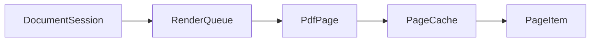

# Architecture

SweetPDF splits into a UI-free document core and a Qt Widgets front end.

```
src/
  core/           Document model and rendering (Qt Core/Gui only)
    pdf/          MuPDF boundary: documents, pages, text, annotations,
                  forms, content, export
    render/       Bitmap cache and worker queue
    session/      Per-document state, tools, undo
    util/         Logging
  ui/             Widgets and chrome
    theme/        Palette, fonts, icons, stylesheet
    ribbon/       Tab strip and command cells
    viewer/       Page canvas, selection, floating bar
    panels/       Sidebar and inspector
    dialogs/      Modals (security, OCR, export, …)
    window/       Main window and home screen
  app/            main() and platform packaging
resources/        Application icon
docs/             Guides and screenshots
```

Module detail: [`src/core/README.md`](../src/core/README.md),
[`src/ui/README.md`](../src/ui/README.md).

## Rules that keep the design honest

1. **`core` never includes Qt Widgets.** Tests and a future CLI can drive the
   same model.
2. **No PDF raster work on the GUI thread.** `RenderQueue` owns worker threads;
   each uses a cloned MuPDF context.
3. **Bitmaps are cached** by `(page, scale, rotation)` under a memory budget.
   Thumbnails share the cache at lower priority.
4. **Scene space is PDF points.** Zoom is a view transform; annotations do not
   need a second coordinate system.
5. **One `DocumentSession` per open file** holds document, render queue, undo
   stack, zoom, page, and tool. Widgets observe it; they do not keep a private
   copy of document state.

## Editing model

| Kind | Examples | Undo |
| --- | --- | --- |
| Annotation-level | Highlight, ink, FreeText, form value | Inverse command on the live document |
| Structural | Page insert/delete/reorder, redaction apply, flatten, merge | Snapshot bytes before/after and reopen (`StructuralEditCommand`) |

Text “editing” today redacts the old glyphs and places a FreeText replacement.
True re-flow of existing font runs is on the roadmap.

## Libraries

| Concern | Library |
| --- | --- |
| UI | Qt 6 |
| Render, text, annotations, redaction | MuPDF (AGPL → project is AGPL) |
| Structural PDF ops (where used) | QPDF |
| OCR | Tesseract + Leptonica |
| Local prefs / recent | SQLite / QSettings |

## Data flow (page on screen)



The viewer asks the session for a page at a scale; the queue rasterises (or
hits cache); `PageItem` paints the pixmap and overlays selection / markup.
